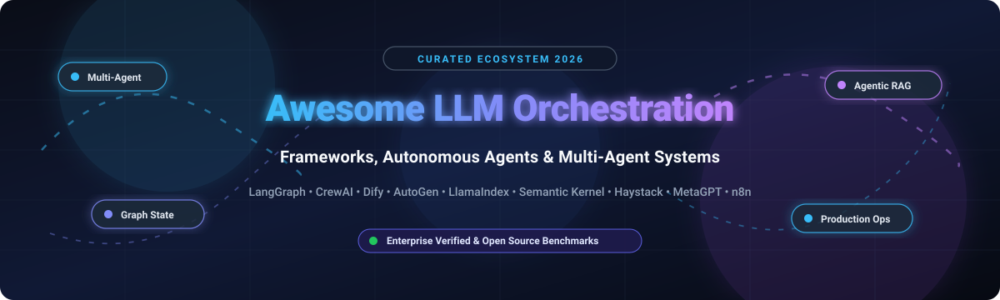

# 🤖 Awesome LLM Orchestration Frameworks

  

  
  
  
  
  

---

## 🌟 Top LLM Orchestration Frameworks & Agentic Systems Ecosystem

> **Curated Index of Enterprise SaaS Platforms & Open-Source Agent Frameworks**  
> *Targeted at Autonomous Agent Orchestration, State Machine Workflows, Agentic RAG, and Production LLMOps Applications.*  
> **Last updated: October 2026**

This repository provides an authoritative, community-maintained directory tracking leading **SaaS platforms** and **open-source frameworks** designed for **LLM Orchestration**, **multi-agent systems**, and **agentic automation**. These systems provide core developer abstractions for prompt pipelining, stateful graph execution, memory persistence, tool execution (including Model Context Protocol / MCP), and production-grade observability and evaluation.

---

## 📑 Table of Contents

- [📊 Sector Overview & Market Dynamics](#-sector-overview--market-dynamics)
- [☁️ SaaS & Hosted Enterprise Platforms](#️-saas--hosted-enterprise-platforms)
- [💻 Open-Source GitHub Frameworks](#-open-source-github-frameworks)
- [🧩 Key Architectural Patterns & Takeaways](#-key-architectural-patterns--takeaways)
- [🤝 How to Contribute](#-how-to-contribute)
- [☕ Support & Sponsorship](#-support--sponsorship)
- [📈 Star History](#-star-history)
- [⚖️ Disclaimer & License Notes](#️-disclaimer--license-notes)

---

## 📊 Sector Overview & Market Dynamics

The global AI and LLM orchestration market is estimated at **$11.02B – $13.7B in 2025–2026**, projected to surge beyond **$30.2B by 2030** (CAGR ~22–35%) as enterprises shift from basic single-prompt LLM wrappers to multi-agent production workflows. The sector is **moderately fragmented**—while foundational runtimes like LangChain and LlamaIndex command massive developer mindshare, the market avoids winner-take-all dynamics due to rapid protocol standardization (MCP and A2A) and specialized enterprise demands across visual builders, deterministic graph execution, and governance layers.

---

## ☁️ SaaS & Hosted Enterprise Platforms

The table below catalogs premier commercial and hosted SaaS platforms for building, tracing, evaluating, and operating production LLM applications. Entities are ranked by **Company Size / Valuation** in descending order.

| Platform | Company Size / Valuation | Starting Paid Tier Pricing | Free Tier / Free Trial Limits | Primary Focus & Highlights |
| :--- | :--- | :--- | :--- | :--- |
| **[Flowise Cloud](https://flowiseai.com/)** | **Parent: $67.5B Market Cap** *(Acquired by Workday in Aug 2025)* | **$35/month** *(Starter Tier)* | **Free Plan ($0/mo forever)**: 2 flows, limited monthly predictions, community support | Drag-and-drop low-code LLM application builder running visual flows for LangChain.js & tools. |
| **[LangSmith](https://smith.langchain.com/)** | **$1.25B Valuation** *($125M Series B led by IVP; ~$16M ARR)* | **$39/seat/month** *(Plus Tier)* | **Developer Plan ($0/mo forever)**: 1 seat, 5,000 traces/mo, 14-day retention, 50,000 events/hr | Unified LLM tracing, prompt versioning, offline evaluation, and LangGraph deployment suite. |
| **[Braintrust](https://www.braintrust.dev/)** | **$800M Valuation** *($80M Series B led by ICONIQ)* | **$249/month** *(Pro Tier, flat team pricing)* | **Starter Plan ($0/mo forever)**: Unlimited seats, 10,000 scores/mo, 1 GB data/mo, 14-day retention, $10 gateway credits | Eval-driven LLM development platform treating prompts and agents as CI/CD test artifacts. |
| **[Dify Cloud](https://dify.ai/)** | **$180M Valuation** *($30M Series Pre-A led by HSG)* | **$59/workspace/month** *(Professional Tier)* | **Sandbox Plan ($0/mo forever)**: 200 message credits, 1 workspace, 1 member, 5 apps, 50 docs (50MB storage), 3,000 trigger events | Turnkey AI application orchestration platform integrating visual RAG, prompt tuning, and agent runtime. |
| **[Vellum](https://www.vellum.ai/)** | **$25.5M+ Total Raised** *(Series A led by Leaders Fund; ~$3.5M ARR)* | **$30/month** *(Mighty Tier; $100/mo Super Tier)* | **Base Plan ($0/mo forever)**: Small compute instance (1 vCPU, 2 GiB RAM), 6 GiB persistent storage, managed LLM credits | Enterprise AI product platform covering prompt engineering, automated regression tests, and workflow deployment. |
| **[PromptLayer](https://www.promptlayer.com/)** | **$4.8M Seed Raised** *(Led by ScOp VC & Stellation Capital)* | **$49/month** *(Pro Tier; $500/mo Team Tier)* | **Free Plan ($0/mo forever)**: Up to 5 users, 2,500 requests/mo, 10 prompts, 10 playground runs/day, 750 agent node runs/mo | Specialized prompt management system, regression testing, output evaluation, and token auditing. |

---

## 💻 Open-Source GitHub Frameworks

Curated open-source repositories powering local, enterprise-hosted, and transparent agentic architectures. Repositories are ranked strictly by **GitHub Stars_Count** (descending) with direct links to their stargazers page.

| Repository | GitHub_Stars | License | Architecture & Description |
| :--- | :--- | :--- | :--- |
| **[n8n](https://github.com/n8n-io/n8n)** |  | Sustainable Use (Fair-code) | **Fair-code workflow automation** with 400+ built-in service connectors, visual flowchart UX, and dedicated native AI Agent nodes for autonomous multi-step pipelines. |
| **[AutoGPT](https://github.com/Significant-Gravitas/AutoGPT)** |  | MIT | **Pioneering autonomous agent vision** — modular agent builder platform, benchmark arena, and execution graph engine for long-horizon task completion. |
| **[Dify](https://github.com/langgenius/dify)** |  | Modified Apache-2.0 | **Production-grade visual agent builder** — full-stack Docker Compose system uniting prompt pipelines, complex visual branching, vector RAG retrieval, and instant REST API generation. |
| **[Langflow](https://github.com/langflow-ai/langflow)** |  | MIT | **Visual canvas for Python AI architectures** — natively supports LangChain and LangGraph state machines, cyclic agent loops, dynamic prompt inputs, and one-click Python code export. |
| **[LangChain](https://github.com/langchain-ai/langchain)** |  | MIT | **De facto standard general-purpose LLM ecosystem** — battle-tested primitives for prompt composition, document parsers, vector indexes, tools, memory, and 700+ external integrations. |
| **[MetaGPT](https://github.com/FoundationAgents/MetaGPT)** |  | MIT | **Multi-agent software development company simulator** — translates natural language requirements into complete design documents, architectures, tasks, and code using collaborative SOP workflows. |
| **[Mem0](https://github.com/mem0ai/mem0)** |  | Apache-2.0 | **Universal intelligent memory layer for AI agents** — dynamic, self-improving personalization across user sessions, state management, and long-term vector-graph associative recall. |
| **[LiteLLM](https://github.com/BerriAI/litellm)** |  | MIT | **Universal LLM proxy & router gateway** — call 100+ LLMs using standardized OpenAI format with automatic fallback, load balancing, virtual keys, rate limiting, and spend tracking. |
| **[AutoGen](https://github.com/microsoft/autogen)** |  | MIT | **Conversational multi-agent platform** — enables collaborative, conversational task decomposition where autonomous agent personas converse, execute code, and self-correct. |
| **[CrewAI](https://github.com/crewAIInc/crewAI)** |  | MIT | **Role-based multi-agent orchestration** — clean developer ergonomics to define autonomous crews with specific roles, goals, delegated tasks, and event-driven CrewAI Flows. |
| **[Flowise](https://github.com/FlowiseAI/Flowise)** |  | Apache-2.0 | **Lightweight node-based drag-and-drop LLM builder** — built on LangChain.js, requires only 1 GB RAM, easily self-hosted as a single Docker container with dozens of vector stores. |
| **[LlamaIndex](https://github.com/run-llama/llama_index)** |  | MIT | **Premier data framework for context-augmented LLMs** — unmatched ingestion, indexing, hierarchical chunking, hybrid retrieval, and agentic query engines across unstructured enterprise data. |
| **[LangGraph](https://github.com/langchain-ai/langgraph)** |  | MIT | **Deterministic graph-based agent orchestration** — models multi-agent execution as explicit stateful graphs with native cyclic loops, time-travel checkpoints, and human-in-the-loop validation. |
| **[Agno](https://github.com/agno-agi/agno)** |  | Apache-2.0 | **High-performance lightweight agent framework** *(formerly Phidata)* — pure Python, sub-millisecond overhead, built-in memory, structured output validation, and multi-modal tool integration. |
| **[DSPy](https://github.com/stanfordnlp/dspy)** |  | MIT | **Declarative programming framework for foundation models** — replaces fragile prompt strings with modular algorithms that mathematically compile and optimize prompts against evaluation metrics. |
| **[Langfuse](https://github.com/langfuse/langfuse)** |  | MIT | **Open-source LLM engineering platform** — detailed distributed tracing, prompt management CMS, eval datasets, latency tracking, and token cost analytics for agentic pipelines. |
| **[Semantic Kernel](https://github.com/microsoft/semantic-kernel)** |  | MIT | **Microsoft enterprise AI SDK** — native support for C#, Python, and Java with automated function calling planners, vector connectors, enterprise guardrails, and Azure OpenAI optimizations. |
| **[Haystack](https://github.com/deepset-ai/haystack)** |  | Apache-2.0 | **Modular end-to-end NLP and RAG orchestration framework** — explicit directed acyclic graphs (DAGs) for semantic search, multi-document QA, retrieval routing, and custom agent tool loops. |
| **[CAMEL](https://github.com/camel-ai/camel)** |  | Apache-2.0 | **Communicative Agents for "Mind" Exploration** — pioneering communicative multi-agent research framework exploring autonomous cooperative agent societies and role-playing dynamics. |
| **[PraisonAI](https://github.com/MervinPraison/PraisonAI)** | [?style=social&color=white)](https://github.com/MervinPraison/PraisonAI/stargazers) | MIT | **Low-code multi-agent orchestration wrapper** — combines CrewAI and AutoGen into simple YAML and code configurations with automated self-reflection and grading loops. |
| **[OpenAgents](https://github.com/xlang-ai/OpenAgents)** |  | Apache-2.0 | **Open platform for language agents in the wild** — host and interact with coding, data analysis, and web search agents over standard WebSocket and gRPC networking protocols. |

---

## 🧩 Key Architectural Patterns & Takeaways

1. **The Visual-to-Code Migration Continuum**: Teams frequently validate ideas in visual drag-and-drop builders like **Dify**, **Flowise**, or **n8n**, transitioning to code-first deterministic graph orchestrators (**LangGraph**, **LlamaIndex**, or **Semantic Kernel**) when scaling custom state machines, compliance gates, and CI test suites.
2. **Deterministic State Graphs Over Raw Loops**: Autonomous while-loops have largely been supplanted by graph-based state engines (**LangGraph**, **CrewAI Flows**) that offer persistent checkpointing, time-travel debugging, step rollback, and strict human approval stops.
3. **Open Standardization Protocols**: Framework lock-in is decreasing through protocol decoupling—Anthropic's **Model Context Protocol (MCP)** handles tool and data access uniformly, while interoperable gateway proxies like **LiteLLM** insulate application code from model provider volatility.

---

## 🤝 How to Contribute

Contributions are warmly welcomed! To suggest a new tool or framework:

1. **Fork** this repository.
2. Add or update the listing in `README.md` following the tabular schema.
3. Keep descriptions objective, concise, and include official repository/pricing links.
4. Submit a **Pull Request** with a descriptive summary of changes.

---

## ☕ Support & Sponsorship

If this curated guide helps your engineering workflow, saves you benchmarking hours, or sparks ideas for your agent architecture, please consider supporting the project:

- ⭐ **Star this repository** to improve discoverability.
- 🍴 **Fork and share** with colleagues and AI engineering communities.
- ☕ **Sponsor the maintainer** via the [GitHub Sponsor Dashboard](https://github.com/sponsors/ishandutta2007) to help support continuous tracking and benchmarking of new AI frameworks!

Thank you for being part of the open AI development community! 🚀

---

## 📈 Star History

---

## ⚖️ Disclaimer & License Notes

- This repository is a community-curated technical index and does not represent commercial endorsement.
- Verify software licenses before commercial deployment (e.g., n8n Sustainable Use License restrictions, Dify modified Apache-2.0 SaaS terms).
- Autonomous agents can execute arbitrary tools and code—always enforce bounded permissions, sandboxed container runners, and robust API key management.
